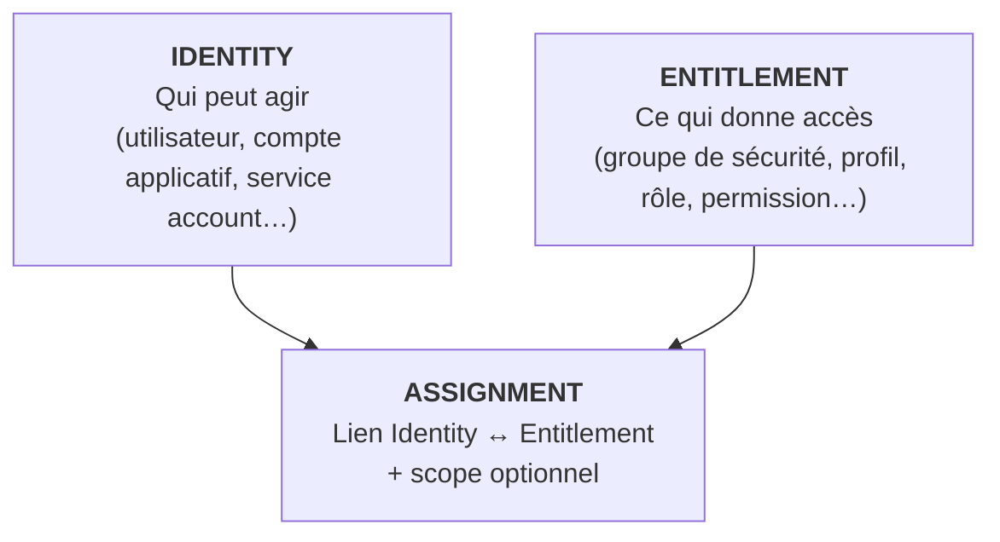
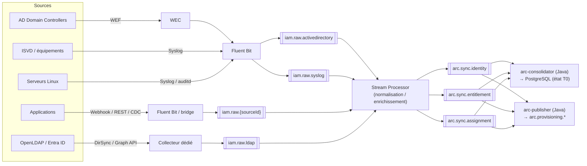

# Modèle Abstrait IAM — InstantAccessProvider

**Generic Identity & Access Model — Spécification fonctionnelle et technique**

| | |
|---|---|
| **Produit** | InstantAccessProvider |
| **Composant concerné** | `arc-consolidator` |
| **Objet** | Modèle d'identité abstrait, catalogue d'événements et règles de mapping par source |
| **Format d'échange** | CloudEvents 1.0 sur Apache Kafka |

---

## Table des matières

1. [Contexte et motivation](#1-contexte-et-motivation)
2. [Modèle abstrait](#2-modèle-abstrait)
3. [Catalogue des événements](#3-catalogue-des-événements)
4. [Architecture multi-source](#4-architecture-multi-source)
5. [Registre des sources (Source Registry)](#5-registre-des-sources-source-registry)
6. [Format des événements (CloudEvents)](#6-format-des-événements-cloudevents)
7. [Correspondances par source](#7-correspondances-par-source)
8. [Cas d'usage CRUD](#8-cas-dusage-crud)
9. [Payloads simplifiés](#9-payloads-simplifiés)

---

## 1. Contexte et motivation

L'architecture initiale était centrée sur Active Directory. Or, les mêmes problématiques se retrouvent dans de nombreux systèmes :

| Système | « Groupe » | « Utilisateur » | « Affectation » |
|---|---|---|---|
| Active Directory | Security Group | User account | `memberOf` |
| Application A | Profil applicatif | Compte applicatif | Utilisateur → Profil |
| OpenLDAP | `groupOfNames` | `inetOrgPerson` | `member` |
| Azure AD / Entra ID | Azure AD Group | User | `memberOf` |
| AWS IAM | IAM Role / Group | IAM User | Role attachment |
| Kubernetes RBAC | ClusterRole | ServiceAccount | RoleBinding |
| Application B (ITSM) | Permission level | Agent | Agent → Permission |

> **Principe directeur** : tous ces systèmes se ramènent aux mêmes **trois entités abstraites** et aux mêmes **types d'événements**. Les schémas Kafka s'appuient sur ces abstractions, et non sur les concepts natifs de chaque système.

---

## 2. Modèle abstrait

### 2.1 Vue d'ensemble



| Entité | Rôle | Équivalents selon les systèmes |
|---|---|---|
| **Identity** | Qui peut agir | User AD, compte applicatif, service account |
| **Entitlement** | Ce qui donne accès | Security Group AD, profil applicatif, `groupOfNames` LDAP, IAM Role AWS, ClusterRole K8s |
| **Assignment** | Le lien entre Identity et Entitlement, avec périmètre métier optionnel | `memberOf` AD, Utilisateur → Profil, RoleBinding |

### 2.2 Identity

> Entité pouvant être authentifiée et à laquelle des droits peuvent être affectés.

| Champ | Type | Description |
|---|---|---|
| `id` | UUID | Identifiant stable généré par la plateforme |
| `externalId` | string | Identifiant dans le système source (SID, UID, UUID applicatif…) |
| `system` | string | Système d'origine (`activedirectory`, `app-a`, `ldap`, `entra-id`) |
| `type` | enum | `user` / `service` / `machine` / `robot` / `guest` |
| `displayName` | string | Nom lisible |
| `metadata` | map | Champs additionnels libres (department, email…) |

**Mapping par système source**

| Système | `externalId` | `type` | Exemples de `metadata` |
|---|---|---|---|
| Active Directory | SID (`S-1-5-21-…`) | `user` ou `service` | `samAccountName`, `upn`, `department` |
| Application A | UUID applicatif | `user` | `login`, `email`, `tenant` |
| OpenLDAP | `dn` de l'entrée | `user` | `uid`, `mail`, `ou` |
| Azure AD | Object ID (GUID) | `user` / `guest` | `userPrincipalName` |

### 2.3 Entitlement

> Ensemble nommé de droits ou d'accès pouvant être affecté à des identités. C'est l'unité d'octroi d'accès.

| Champ | Type | Description |
|---|---|---|
| `id` | UUID | Identifiant stable généré par la plateforme |
| `externalId` | string | Identifiant dans le système source (SID du groupe, ID du profil…) |
| `system` | string | Système d'origine |
| `name` | string | Nom lisible (`Domain Admins`, `PROFIL_GESTIONNAIRE`, `admin-role`) |
| `type` | enum | `security-group` / `distribution-group` / `app-profile` / `role` / `permission-set` |
| `sensitivityLevel` | enum | `LOW` / `MEDIUM` / `HIGH` / `CRITICAL` |
| `owner` | string | Propriétaire fonctionnel |
| `metadata` | map | Champs additionnels libres |

**Mapping par système source**

| Système | `externalId` | `type` | Exemple de `name` |
|---|---|---|---|
| AD — groupe de sécurité | SID du groupe | `security-group` | `Domain Admins` |
| AD — groupe de distribution | SID du groupe | `distribution-group` | `DL-Finance-All` |
| Application A | ID du profil (int / UUID) | `app-profile` | `PROFIL_GESTIONNAIRE` |
| OpenLDAP | `dn` du groupe | `security-group` | `cn=admins,ou=groups,…` |
| AWS IAM | ARN du rôle | `role` | `arn:aws:iam::…:role/Admin` |
| Kubernetes | `name` du ClusterRole | `role` | `cluster-admin` |

### 2.4 Assignment

> Lien effectif entre une Identity et un Entitlement à un instant donné, éventuellement restreint à un périmètre métier (scope).

| Champ | Type | Description |
|---|---|---|
| `id` | UUID | Identifiant stable de l'affectation |
| `identityId` | UUID | Référence vers l'Identity (id plateforme) |
| `entitlementId` | UUID | Référence vers l'Entitlement (id plateforme) |
| `system` | string | Système source de l'affectation |
| `grantedBy` | Identity ref | Auteur de l'affectation |
| `grantedAt` | datetime | Horodatage de l'affectation |
| `expiresAt` | datetime? | Date d'expiration, le cas échéant |
| `scope` | Scope? | **Optionnel** — périmètre métier (cf. [§2.5](#25-scope-optionnel)) |
| `metadata` | map | Champs additionnels libres |

### 2.5 Scope (optionnel)

> Périmètre métier restreignant l'exercice d'un Entitlement à une portion de données ou d'organisation.

Le scope n'est pas un Entitlement : il ne définit pas *ce que l'on peut faire* mais *sur quoi on peut le faire*. Il est porté par l'**Assignment** et non par l'Entitlement, car un même droit peut s'appliquer avec des périmètres différents selon les personnes.

**Exemples**

| Contexte | Entitlement | Scope |
|---|---|---|
| RH multinationale | `PROFIL_RH_MANAGER` | `region: EMEA` |
| Gestion documentaire | `ACCES_CONTRATS` | `service: Direction Juridique` |
| Application financière | `ROLE_VALIDEUR` | `entity: Filiale-FR-01` |
| Active Directory | `Domain Admins` | *(aucun — s'applique au domaine entier)* |
| Support N2 | `PROFIL_SUPPORT` | `country: FR`, `tier: premium` |

**Structure d'une dimension**

| Champ | Type | Description |
|---|---|---|
| `type` | string | Type de dimension (`region`, `entity`, `service`, `country`, `tenant`…) |
| `value` | string \| string[] | Valeur(s) du périmètre |
| `label` | string? | Libellé lisible |

Plusieurs dimensions peuvent être combinées dans un même scope :

```json
"scope": {
  "dimensions": [
    { "type": "region", "value": "EMEA",             "label": "Europe, Moyen-Orient, Afrique" },
    { "type": "entity", "value": ["FR-01", "FR-02"], "label": "Filiales France" }
  ]
}
```

> **Règle de compatibilité** : le champ `scope` est **absent** lorsque l'Entitlement s'applique sans restriction de périmètre. Cette absence est un état valide. Les consommateurs qui ne gèrent pas le scope doivent ignorer le champ sans erreur (rétrocompatibilité garantie).

---

## 3. Catalogue des événements

Quel que soit le système source, les événements se réduisent à **dix types**, répartis sur trois topics.

| Topic | Type d'événement | Équivalent Active Directory / applicatif |
|---|---|---|
| `arc.sync.identity` | `arc.sync.identity.created` | 4720 / création de compte applicatif |
| | `arc.sync.identity.updated` | 4738, 4781 / modification du profil utilisateur |
| | `arc.sync.identity.deleted` | 4726 / suppression de compte |
| | `arc.sync.identity.enabled` | 4722 / activation |
| | `arc.sync.identity.disabled` | 4725 / désactivation |
| `arc.sync.entitlement` | `arc.sync.entitlement.created` | 4727, 4731, 4754 / création de profil applicatif |
| | `arc.sync.entitlement.updated` | Modification de groupe ou de profil |
| | `arc.sync.entitlement.deleted` | 4730, 4734, 4758 / suppression de profil |
| `arc.sync.assignment` | `arc.sync.assignment.added` | 4728, 4732, 4756 / Utilisateur → Profil applicatif |
| | `arc.sync.assignment.removed` | 4729, 4733, 4757 / retrait |

---

## 4. Architecture multi-source

La collecte est assurée par **Fluent Bit** ou **CAESAR** sur les serveurs de collecte (WEC, collecteurs syslog…). Le traitement métier est assuré en aval par le **Stream Processor**.



### Responsabilités

| Composant | Responsabilités |
|---|---|
| **Fluent Bit** | Écoute des protocoles de collecte (winlog, syslog, http, tail) ; enrichissement technique minimal (tags source / zone / collecteur) ; publication fiable dans `iam.raw.{sourceId}` |
| **Stream Processor** | Mapping métier vers le modèle IAM abstrait ; enrichissement (LDAP, CMDB, UO AD) ; publication des topics normalisés `arc.sync.*` |
| **arc-consolidator** | Consommation de `arc.sync.*` ; consolidation de l'état de référence (T0) dans PostgreSQL |
| **arc-publisher** | Consommation de `arc.sync.*` ; publication vers `arc.provisioning.*` |

### Justification d'un topic *raw* par source

- Rejeu d'une seule source sans impact sur les autres.
- Schémas bruts propres à chaque source, sans couplage.
- Isolation des pannes : un collecteur ou un flux en erreur n'affecte pas les autres.

---

## 5. Registre des sources (Source Registry)

Chaque système source doit s'enregistrer dans le **Source Registry** avant de produire des événements. Ce registre est la clé de l'interopérabilité.

**Exemple — Active Directory**

```json
{
  "sourceId": "ad://corp.example.com",
  "sourceType": "activedirectory",
  "displayName": "Active Directory - corp.example.com",
  "domain": "corp.example.com",
  "collecteur": "collecteur-ad-v2",
  "entityMapping": {
    "identity": "user account",
    "entitlement": "security group",
    "assignment": "group membership"
  },
  "sensitiveEntitlements": [
    { "namePattern": "Domain Admins", "level": "CRITICAL" },
    { "namePattern": "VPN-*", "level": "MEDIUM" }
  ],
  "registeredAt": "2026-01-15T09:00:00Z"
}
```

**Exemple — Application métier**

```json
{
  "sourceId": "app://app-a.example.com",
  "sourceType": "business-application",
  "displayName": "Application A — Gestion RH",
  "collecteur": "collecteur-app-webhook-v1",
  "entityMapping": {
    "identity": "utilisateur applicatif",
    "entitlement": "profil applicatif",
    "assignment": "affectation utilisateur → profil"
  },
  "sensitiveEntitlements": [
    { "namePattern": "PROFIL_ADMIN_*", "level": "HIGH" },
    { "namePattern": "PROFIL_EXPORT_PAIE", "level": "CRITICAL" }
  ],
  "registeredAt": "2026-02-01T10:30:00Z"
}
```

---

## 6. Format des événements (CloudEvents)

Les événements `arc.sync.*` respectent la spécification CloudEvents 1.0. L'enveloppe est identique pour toutes les sources ; seuls `source`, `iamsourcetype` et `data.entitlement.type` varient.

### 6.1 Assignment — Active Directory

`arc.sync.assignment.added`

```json
{
  "specversion": "1.0",
  "id": "7c9e6679-7425-40de-944b-e07fc1f90ae7",
  "source": "ad://corp.example.com",
  "type": "arc.sync.assignment.added",
  "time": "2026-04-02T14:32:11.123Z",
  "datacontenttype": "application/json",
  "iamsourcetype": "activedirectory",

  "data": {
    "assignment": {
      "id": "a1b2c3d4-...",
      "grantedAt": "2026-04-02T14:32:11.123Z",
      "grantedBy": {
        "externalId": "S-1-5-21-...-500",
        "displayName": "admin.service",
        "system": "ad://corp.example.com"
      }
    },
    "identity": {
      "id": "f47ac10b-...",
      "externalId": "S-1-5-21-...-1105",
      "system": "ad://corp.example.com",
      "type": "user",
      "displayName": "John Doe",
      "metadata": {
        "samAccountName": "john.doe",
        "upn": "john.doe@corp.example.com",
        "department": "IT"
      }
    },
    "entitlement": {
      "id": "e7d3a021-...",
      "externalId": "S-1-5-21-...-512",
      "system": "ad://corp.example.com",
      "type": "security-group",
      "name": "Domain Admins",
      "sensitivityLevel": "CRITICAL",
      "metadata": {
        "distinguishedName": "CN=Domain Admins,CN=Users,DC=corp,DC=example,DC=com",
        "nativeEventId": 4728
      }
    },
    "context": {
      "isOutsideBusinessHours": false,
      "isPrivilegedEntitlement": true,
      "sourceNativeEventId": "4728"
    }
  }
}
```

### 6.2 Assignment avec scope — Application RH

`arc.sync.assignment.added`

```json
{
  "specversion": "1.0",
  "id": "3e4f5a06-cd23-...",
  "source": "app://sirh.example.com",
  "type": "arc.sync.assignment.added",
  "time": "2026-04-03T09:15:00.000Z",
  "iamsourcetype": "business-application",

  "data": {
    "assignment": {
      "id": "c1d2e3f4-...",
      "grantedAt": "2026-04-03T09:15:00.000Z",
      "grantedBy": {
        "externalId": "admin-rh-001",
        "displayName": "Administrateur RH",
        "system": "app://sirh.example.com"
      },
      "scope": {
        "dimensions": [
          { "type": "region", "value": "EMEA", "label": "Europe, Moyen-Orient, Afrique" }
        ]
      }
    },
    "identity": {
      "id": "a1b2c3d4-...",
      "externalId": "emp-00789",
      "system": "app://sirh.example.com",
      "type": "user",
      "displayName": "Marie Dupont",
      "metadata": { "email": "m.dupont@corp.example.com" }
    },
    "entitlement": {
      "id": "b2c3d4e5-...",
      "externalId": "profile-rh-manager",
      "system": "app://sirh.example.com",
      "type": "app-profile",
      "name": "PROFIL_RH_MANAGER",
      "sensitivityLevel": "HIGH"
    },
    "context": {
      "isOutsideBusinessHours": false,
      "isPrivilegedEntitlement": true,
      "sourceNativeEventId": "SIRH_ASSIGN_884421"
    }
  }
}
```

> Sans le champ `scope`, l'affectation s'applique sans restriction de périmètre. Son absence est un état valide et ne doit pas être interprétée comme une erreur.

### 6.3 Assignment — Application A (profil applicatif)

`arc.sync.assignment.added`

```json
{
  "specversion": "1.0",
  "id": "9f1e3a02-ab12-...",
  "source": "app://app-a.example.com",
  "type": "arc.sync.assignment.added",
  "time": "2026-04-02T15:01:00.000Z",
  "iamsourcetype": "business-application",

  "data": {
    "assignment": {
      "id": "b2c3d4e5-...",
      "grantedAt": "2026-04-02T15:01:00.000Z",
      "grantedBy": {
        "externalId": "user-admin-001",
        "displayName": "Administrateur App A",
        "system": "app://app-a.example.com"
      }
    },
    "identity": {
      "id": "c3d4e5f6-...",
      "externalId": "user-00234",
      "system": "app://app-a.example.com",
      "type": "user",
      "displayName": "Jane Smith",
      "metadata": {
        "login": "jsmith",
        "email": "jane.smith@corp.example.com",
        "tenant": "corp"
      }
    },
    "entitlement": {
      "id": "d4e5f6a7-...",
      "externalId": "profile-003",
      "system": "app://app-a.example.com",
      "type": "app-profile",
      "name": "PROFIL_EXPORT_PAIE",
      "sensitivityLevel": "CRITICAL",
      "metadata": {
        "description": "Accès export données de paie",
        "ownerTeam": "RH-Admin"
      }
    },
    "context": {
      "isOutsideBusinessHours": true,
      "isPrivilegedEntitlement": true,
      "sourceNativeEventId": "APP_PROFILE_ASSIGN_V2"
    }
  }
}
```

> Les trois événements ci-dessus partagent le même `type` (`arc.sync.assignment.added`), le même schéma et les mêmes règles de détection SOC. Seuls `source` et `data.entitlement.type` différencient l'origine.

---

## 7. Correspondances par source

### 7.1 Active Directory

#### Entités

| Natif AD | Abstraction IAM | Valeur de `type` |
|---|---|---|
| UserAccount | Identity | `user` ou `service` |
| Security Group | Entitlement | `security-group` |
| Distribution Group | Entitlement | `distribution-group` |
| `memberOf` | Assignment | — |

#### Event IDs gérés

| Event ID | Description | Abstraction | Événement ARC |
|---|---|---|---|
| 4720 | Création de compte utilisateur | Identity | `arc.sync.identity.created` |
| 4722 | Activation de compte utilisateur | Identity | `arc.sync.identity.enabled` |
| 4725 | Désactivation de compte utilisateur | Identity | `arc.sync.identity.disabled` |
| 4726 | Suppression de compte utilisateur | Identity | `arc.sync.identity.deleted` |
| 4738 | Modification de compte utilisateur (attributs modifiés détaillés) | Identity | `arc.sync.identity.updated` |
| 4781 | Renommage de compte utilisateur | Identity | `arc.sync.identity.updated` |
| 4727 | Création de groupe de sécurité global | Entitlement | `arc.sync.entitlement.created` |
| 4731 | Création de groupe de sécurité local | Entitlement | `arc.sync.entitlement.created` |
| 4754 | Création de groupe universel | Entitlement | `arc.sync.entitlement.created` |
| 4730 | Suppression de groupe de sécurité global | Entitlement | `arc.sync.entitlement.deleted` |
| 4734 | Suppression de groupe local | Entitlement | `arc.sync.entitlement.deleted` |
| 4758 | Suppression de groupe universel | Entitlement | `arc.sync.entitlement.deleted` |
| 4728 | Ajout d'un membre à un groupe global | Assignment | `arc.sync.assignment.added` |
| 4732 | Ajout d'un membre à un groupe local | Assignment | `arc.sync.assignment.added` |
| 4756 | Ajout d'un membre à un groupe universel | Assignment | `arc.sync.assignment.added` |
| 4729 | Retrait d'un membre d'un groupe global | Assignment | `arc.sync.assignment.removed` |
| 4733 | Retrait d'un membre d'un groupe local | Assignment | `arc.sync.assignment.removed` |
| 4757 | Retrait d'un membre d'un groupe universel | Assignment | `arc.sync.assignment.removed` |

### 7.2 Application générique (REST / Webhook / CDC)

| Natif application | Abstraction IAM | Valeur de `type` / événement ARC |
|---|---|---|
| Utilisateur applicatif | Identity | `user` |
| Profil / rôle applicatif | Entitlement | `app-profile` ou `role` |
| Affectation Utilisateur → Profil | Assignment | — |
| Création de profil | — | `arc.sync.entitlement.created` |
| Affectation de profil | — | `arc.sync.assignment.added` |
| Retrait de profil | — | `arc.sync.assignment.removed` |

### 7.3 OpenLDAP

| Natif LDAP | Abstraction IAM | Valeur de `type` / événement ARC |
|---|---|---|
| `inetOrgPerson` | Identity | `user` |
| `groupOfNames` | Entitlement | `security-group` |
| Attribut `member` | Assignment | — |
| DirSync — ajout d'une entrée | — | `arc.sync.identity.created` |
| DirSync — modification de `member` | — | `arc.sync.assignment.added` / `removed` |

---

## 8. Cas d'usage CRUD

### 8.1 Groupe (Entitlement)

| Opération | Event IDs AD |
|---|---|
| Création | 4727, 4731, 4754 |
| Modification | Pas d'Event ID dédié dans le périmètre actuel |
| Suppression | 4730, 4734, 4758 |

### 8.2 Affectation (Assignment)

| Opération | Event IDs AD |
|---|---|
| Ajout d'un utilisateur dans un groupe | 4728, 4732, 4756 |
| Retrait d'un utilisateur d'un groupe | 4729, 4733, 4757 |

Le champ `scope` est optionnel et permet de restreindre l'affectation à un périmètre métier.

**Avec scope**

```json
{
  "eventType": "arc.sync.assignment.added",
  "identityId": "...",
  "entitlementId": "...",
  "scope": {
    "dimensions": [
      { "type": "region", "value": "EMEA" },
      { "type": "entity", "value": ["FR-01", "FR-02"] }
    ]
  }
}
```

**Sans scope**

```json
{
  "eventType": "arc.sync.assignment.added",
  "identityId": "...",
  "entitlementId": "..."
}
```

---

## 9. Payloads simplifiés

Schémas recommandés pour les événements métier consommés par `arc-consolidator`. Le champ `operation` qualifie l'action ; `changes` détaille les modifications lors d'un `updated`.

### 9.1 Identity

**Création**

```json
{
  "operation": "created",
  "identity": {
    "id": "f47ac10b-...",
    "externalId": "S-1-5-21-...",
    "displayName": "wef-test-0554",
    "type": "user",
    "system": "ad://corp.example.com",
    "metadata": { }
  }
}
```

**Modification**

```json
{
  "operation": "updated",
  "identity": {
    "id": "f47ac10b-...",
    "displayName": "wef-test-0554"
  },
  "changes": [
    { "field": "department", "old": "IT", "new": "Finance" },
    { "field": "email", "old": "john@corp.com", "new": "john.doe@corp.com" }
  ]
}
```

### 9.2 Entitlement (groupe)

**Création**

```json
{
  "operation": "created",
  "entitlement": {
    "id": "e7d3a021-...",
    "externalId": "S-1-5-21-...-512",
    "name": "Domain Admins",
    "type": "security-group",
    "system": "ad://corp.example.com",
    "metadata": { }
  }
}
```

**Modification**

```json
{
  "operation": "updated",
  "entitlement": {
    "id": "e7d3a021-...",
    "name": "Domain Admins"
  },
  "changes": [
    { "field": "owner", "old": "IT", "new": "Security" }
  ]
}
```

### 9.3 Assignment

**Ajout**

```json
{
  "operation": "added",
  "assignment": {
    "id": "a1b2c3d4-...",
    "identityId": "f47ac10b-...",
    "identityDisplayName": "wef-test-0554",
    "entitlementId": "e7d3a021-...",
    "entitlementName": "Domain Admins",
    "grantedAt": "2026-04-02T14:32:11.123Z",
    "system": "ad://corp.example.com"
  }
}
```

**Retrait**

```json
{
  "operation": "removed",
  "assignment": {
    "identityDisplayName": "wef-test-0554",
    "entitlementName": "Domain Admins"
  }
}
```
