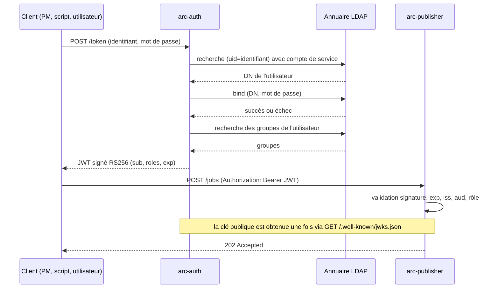

# 13 — Authentification et jetons JWT (`arc-auth`)

> **Statut : conception.** `arc-auth` n'est pas encore implémenté. Aujourd'hui, l'API d'`arc-publisher` (`POST /jobs`) n'est pas authentifiée : elle n'est exposée que sur `127.0.0.1` dans la démonstration et doit être protégée par le réseau en déploiement.

## 1. Objectifs

| Objectif | Description |
|---|---|
| **Authentifier** | Vérifier l'identité d'un utilisateur ou d'un compte de service à partir d'un annuaire LDAP (Apache DS en démo, OpenLDAP ou autre en production). |
| **Émettre un jeton** | Délivrer un jeton **JWT signé** à durée de vie courte, portant l'identité et les rôles. |
| **Protéger les API** | Permettre à `arc-publisher` et `product-manager` de vérifier le jeton sans contacter `arc-auth` à chaque appel. |

Hors périmètre initial : fédération (OIDC complet, SAML), jetons de rafraîchissement, interface de connexion, authentification multifacteur (à traiter par l'annuaire ou un fournisseur d'identité en amont).

## 2. Architecture

`arc-auth` est un **service séparé**, sans état métier. Il ne stocke aucun mot de passe : la vérification est déléguée à l'annuaire par **bind LDAP**.



## 3. API d'`arc-auth`

| Méthode et chemin | Description | Accès |
|---|---|---|
| `POST /token` | Corps JSON `{ "username": "...", "password": "..." }`. Retourne `200` avec `{ "access_token": "...", "token_type": "Bearer", "expires_in": 900 }` ou `401` (message générique identique pour utilisateur inconnu et mot de passe erroné). | Public |
| `GET /.well-known/jwks.json` | Clés publiques de signature (JWKS) | Public |
| `GET /actuator/health` | Santé du service (connexion LDAP) | Interne |

## 4. Authentification LDAP

Mécanisme : **bind authentication** (Spring Security LDAP, `BindAuthenticator`).

1. Connexion à l'annuaire avec un compte de service en lecture seule.
2. Recherche de l'utilisateur : `(uid={0})` sous `ARC_AUTH_LDAP_USER_SEARCH_BASE`.
3. Tentative de bind avec le DN trouvé et le mot de passe fourni. Le mot de passe n'est jamais comparé ni lu côté `arc-auth`.
4. Recherche des groupes (`groupOfNames`, attribut `member` = DN de l'utilisateur) sous `ARC_AUTH_LDAP_GROUP_SEARCH_BASE`.
5. Transformation des groupes en rôles (section 5).

Verrouillage de compte, politique de mot de passe et expiration relèvent de l'annuaire. `arc-auth` ajoute une limitation de débit par adresse source et par identifiant (réponse `429`) pour freiner les attaques par essais successifs.

## 5. Contenu du jeton

Signature **RS256** (clé asymétrique) : les services protégés n'ont besoin que de la clé publique.

En-tête : `{ "alg": "RS256", "typ": "JWT", "kid": "<identifiant de clé>" }`

Revendications :

| Claim | Valeur |
|---|---|
| `iss` | Émetteur (`ARC_AUTH_JWT_ISSUER`, ex. `https://arc-auth.example.com`) |
| `sub` | Identifiant de l'utilisateur (`uid`) |
| `aud` | Audience (`ARC_AUTH_JWT_AUDIENCE`, ex. `arc`) |
| `iat`, `nbf`, `exp` | Émission, début de validité, expiration (durée de vie par défaut : 15 minutes) |
| `jti` | Identifiant unique du jeton |
| `name` | Nom d'affichage (`cn`) |
| `roles` | Liste de rôles dérivés des groupes LDAP |

Table de correspondance groupes → rôles (configurable, `arc.auth.role-mapping`) :

| Groupe LDAP | Rôle |
|---|---|
| `cn=arc-admins,ou=Groups,…` | `ARC_ADMIN` |
| `cn=arc-publishers,ou=Groups,…` | `ARC_PUBLISHER` |
| `cn=arc-readers,ou=Groups,…` | `ARC_READER` |

Les groupes non listés ne produisent aucun rôle. Aucun mot de passe, aucune donnée sensible autre que le nom d'affichage n'est placé dans le jeton.

## 6. Gestion des clés

| Sujet | Règle |
|---|---|
| Génération | Paire RSA 2048 bits minimum, créée hors du service et fournie par secret (`ARC_AUTH_JWT_PRIVATE_KEY_PATH`). En démonstration seulement, génération éphémère au démarrage (les jetons n'y survivent pas à un redémarrage). |
| Identification | `kid` dans chaque jeton ; le JWKS publie toutes les clés actives. |
| Rotation | Ajout de la nouvelle clé au JWKS, bascule de la signature, retrait de l'ancienne après expiration du dernier jeton signé avec elle. |
| Algorithme | RS256 uniquement ; les services rejettent `none` et tout algorithme autre que celui attendu. |

## 7. Protection des services (ressource serveur)

`arc-publisher` et `product-manager` valident le jeton avec Spring Security `oauth2-resource-server` : récupération du JWKS via `jwk-set-uri` (mise en cache), contrôle de la signature, de `exp`/`nbf`, de `iss` et `aud`. La configuration de sécurité est placée dans la couche **infrastructure** ; le domaine n'a aucune dépendance à Spring Security.

| Service | Endpoint | Rôle requis |
|---|---|---|
| `arc-publisher` | `POST /jobs` | `ARC_PUBLISHER` ou `ARC_ADMIN` |
| `arc-publisher` | `GET /jobs/**` | `ARC_READER`, `ARC_PUBLISHER` ou `ARC_ADMIN` |
| `arc-publisher` | `/actuator/health` | public |
| `product-manager` | API métier | rôles définis par le service (à spécifier) |

`product-manager`, qui appelle `arc-publisher`, s'authentifie auprès d'`arc-auth` avec un **compte de service** (entrée sous `ou=ServiceAccounts`, appartenant à `arc-publishers`) et transmet le jeton obtenu. Le jeton du compte de service est réutilisé jusqu'à son expiration puis renouvelé.

Le traçage du `jobId` est complété par `sub` du jeton (« qui a demandé ce provisioning »), transmis dans les journaux et dans `correlationId` / métadonnées du job.

## 8. Configuration

| Variable | Rôle | Défaut |
|---|---|---|
| `ARC_AUTH_LDAP_URL` | Annuaire | `ldap://localhost:10389` |
| `ARC_AUTH_LDAP_MANAGER_DN` / `ARC_AUTH_LDAP_MANAGER_PASSWORD` | Compte de service en lecture seule | — |
| `ARC_AUTH_LDAP_USER_SEARCH_BASE` | Base de recherche des utilisateurs | `ou=Users,dc=example,dc=com` |
| `ARC_AUTH_LDAP_USER_SEARCH_FILTER` | Filtre de recherche | `(uid={0})` |
| `ARC_AUTH_LDAP_GROUP_SEARCH_BASE` | Base de recherche des groupes | `ou=Groups,dc=example,dc=com` |
| `ARC_AUTH_JWT_ISSUER` | Valeur de `iss` | — |
| `ARC_AUTH_JWT_AUDIENCE` | Valeur de `aud` | `arc` |
| `ARC_AUTH_JWT_TTL` | Durée de vie du jeton | `PT15M` |
| `ARC_AUTH_JWT_PRIVATE_KEY_PATH` | Clé privée PEM | clé éphémère (démo seulement) |
| `ARC_AUTH_JWT_KEY_ID` | `kid` | généré |

Côté services protégés : `SPRING_SECURITY_OAUTH2_RESOURCESERVER_JWT_JWK_SET_URI`, `..._ISSUER_URI` et `ARC_SECURITY_AUDIENCE`.

## 9. Sécurité

- **TLS obligatoire** entre client et `arc-auth`, et entre `arc-auth` et l'annuaire (`ldaps://` / StartTLS) hors démonstration : le mot de passe transite en clair sinon.
- Réponse `401` uniforme ; aucun détail sur la cause de l'échec ; aucun mot de passe journalisé.
- Entrées échappées dans le filtre de recherche (protection contre l'injection LDAP).
- Durée de vie courte, pas de jeton de rafraîchissement : un jeton volé expire vite. Pas de liste de révocation en première version ; la révocation passe par la durée de vie et la rotation de clé.
- Compte de service de l'annuaire limité à la lecture des branches utilisateurs et groupes.
- En démonstration, les mots de passe sont publics et les ports liés à `127.0.0.1` ; ne jamais réutiliser ces valeurs.

## 10. Démonstration

`arc-auth` est ajouté à `demo/docker-compose.yml` (port `127.0.0.1:8082`), configuré sur le service Apache DS (document 12, section 5). Scénario cible :

```bash
# 1. Obtenir un jeton
TOKEN=$(curl -s -X POST http://localhost:8082/token \
  -H 'Content-Type: application/json' \
  -d '{"username":"bob","password":"<mot de passe de démo>"}' | jq -r .access_token)

# 2. Appeler l'API protégée
curl -X POST http://localhost:8081/jobs \
  -H "Authorization: Bearer $TOKEN" \
  -H 'Content-Type: application/json' \
  -d @job.json
```

Sans jeton ou avec un jeton invalide, `arc-publisher` répond `401` ; avec un rôle insuffisant, `403`.

## 11. Plan de mise en œuvre

1. `arc-auth` : API `/token` et `/.well-known/jwks.json`, bind LDAP, tests sur Apache DS embarqué.
2. Protection de `arc-publisher` (validation JWT, règles par rôle), tests d'API.
3. Ajout à la démonstration et mise à jour des README.
4. Protection de `product-manager` et utilisation du compte de service pour l'appel à `arc-publisher`.

## 12. Points ouverts

1. Conserver un mode « sécurité désactivée » (`ARC_SECURITY_ENABLED=false`) pour le développement local, ou imposer l'authentification partout ?
2. Rôles et endpoints à protéger dans `product-manager` : à spécifier avec l'équipe produit.
3. Stockage de la clé de signature en production (secret Kubernetes, coffre) : dépend de l'environnement de déploiement.
4. Besoin futur d'OIDC (fournisseur d'identité externe) : `arc-auth` pourrait alors être remplacé par un fournisseur du marché sans changer la validation côté services.
