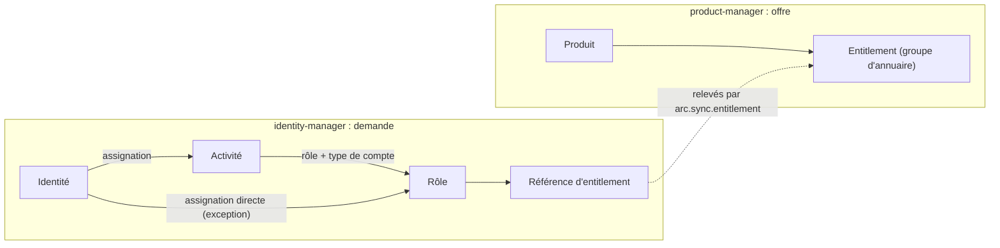

# 15 — Droits : activités, rôles et assignations

> **Statut : proposition de conception, non implémentée.** Elle prolonge les documents 13 (authentification) et 14 (comptes et console) et reprend le vocabulaire du document 01 (§5 et §6, rôles et entitlements). Rien de ce qui suit n'existe encore dans le code ; les points à trancher sont listés en section 8.

## 1. Constat

- Ce que `product-manager` appelle **profil** est aujourd'hui **un seul groupe** d'annuaire (un *entitlement*), créé avec son périmètre (TIER0 à TIER2). Aucun objet ne regroupe plusieurs groupes, ni ne relie un groupe à une identité ou à un compte.
- Un compte créé par ARC (`standard`, `admin`) existe dans l'annuaire mais **n'a aucun droit** : `arc-auth` refuse tout identifiant sans l'un des trois groupes `arc-admins`, `arc-publishers`, `arc-readers`. On ne peut donc pas se connecter à ARC avec un compte qu'ARC a lui-même créé.
- Les trois rôles d'`arc-auth` sont **globaux** : pas de périmètre par produit, par type de compte ou par niveau d'administration.

Il manque un modèle pour **donner des droits** (à une identité ou à une application), de façon traçable, datée et annulable, avec les mêmes garanties que les comptes et les groupes (ordres, `startDate` / `endDate`, annulation d'un ordre en attente).

## 2. Modèle proposé

| Terme | Définition | Porté par |
|---|---|---|
| **Entitlement** (groupe) | Un groupe d'un annuaire cible : système + nom, remonté par les agents sur `arc.sync.entitlement`. C'est ce que la console de `product-manager` appelle aujourd'hui « profil ». | `product-manager` (création), agents (relevé) |
| **Rôle** | Ensemble cohérent d'entitlements, éventuellement de **plusieurs produits**. Son périmètre (TIER0 à TIER2) est le plus élevé de ses entitlements ; il peut porter en plus un niveau de sensibilité. C'est l'équivalent du « rôle » du document 01. | `identity-manager` **exclusivement** |
| **Activité** | Fonction métier regroupant des rôles, éventuellement de plusieurs produits, chacun avec le **type de compte** sur lequel il est délivré. | `identity-manager` |
| **Assignation** | Un sujet (identité ou compte applicatif) reçoit un rôle sur un type de compte, avec des dates facultatives. | `identity-manager` ou `product-manager` selon le sujet |

Le produit décrit **ce qui existe** (les entitlements, l'offre) ; le rôle et l'activité décrivent **ce que fait une personne** (la demande). Les deux évoluent à des rythmes et par des équipes différentes, ce qui justifie de les garder dans deux services distincts : `product-manager` ne connaît ni rôle ni activité.

Les « profils » actuels de `product-manager` ne changent pas : ce sont des entitlements. Les rôles sont une couche ajoutée au-dessus, entièrement dans `identity-manager`, sans migration ni changement du contrat de `product-manager`. Un rôle peut ne contenir qu'un seul entitlement, mais n'y est pas réduit.

## 3. Côté identités (`identity-manager`)

1. Un **rôle** est défini dans `identity-manager` : un nom, une liste d'entitlements choisis parmi ceux relevés sur `arc.sync.entitlement` (tous produits confondus), un périmètre déduit. Une **activité** est une liste de lignes `(rôle, type de compte)`.
2. Assigner une activité à une identité produit des **assignations effectives**, une par couple `(rôle, type de compte)`. Chacune génère un ordre d'ajout aux groupes du rôle sur le compte de l'identité du type demandé.
3. **Cohérence avec le périmètre** : le périmètre du rôle (le plus élevé de ses entitlements) restreint les types de compte possibles (par exemple TIER0 ⇒ compte `admin` uniquement). La table est portée par la configuration, comme les types de compte. Une ligne d'activité incohérente est refusée à la saisie.
4. **Dédoublonnage par comptage de références** : si deux activités contiennent le même rôle sur le même type de compte, un seul ordre d'ajout est émis (passage de 0 à 1) et le retrait n'est émis que lorsque plus aucune source ne le porte (passage de 1 à 0). Retirer une activité ne doit jamais révoquer un droit encore justifié par une autre.
5. **Sources d'une assignation** : `ACTIVITY` (via une activité), `DIRECT` (exception, à justifier) et `DISCOVERED` (appartenance relevée dans l'annuaire sans passer par ARC, comme pour les comptes découverts).
6. **Dates** : les assignations portent `startDate` et `endDate`, avec la même sémantique que les comptes (document 14 §3) : création à la date de début, retrait le lendemain de la date de fin, `cancel-pending` tant que l'ordre n'est pas exécuté.
7. **Compte absent : il est créé.** Une assignation validée est un droit acquis : si elle exige un type de compte que l'identité n'a pas (par exemple `admin`), le compte est **provisionné automatiquement** par un ordre `IDENTITY` de création, émis avant l'ordre d'appartenance (même date d'exécution, ordre garanti par la clé de partition de l'identité). Une activité qui contient un rôle d'administration donne donc à l'identité son compte `admin` sans geste supplémentaire.
   - Le compte créé porte la source `ACTIVITY` (ou `DIRECT`) et le même comptage de références que l'assignation : il est **désactivé puis supprimé** quand plus aucune assignation ne l'exige, jamais avant (le retrait suit la règle de la fin de date, document 14 §3).
   - La validation (sensibilité du rôle) porte sur l'assignation ; elle couvre implicitement la création du compte, qui n'a pas de validation propre.
   - Le type de compte doit exister dans la configuration ; sinon la ligne d'activité est refusée à la saisie, pas à l'exécution.

## 4. Côté produits (`product-manager`)

**Avis : `product-manager` n'a ni rôle ni activité. Il assigne directement des entitlements de son propre produit à ses comptes applicatifs.**

| | Identités | Produits (comptes applicatifs) |
|---|---|---|
| Sujet de l'assignation | une identité humaine | un compte applicatif |
| Regroupement | activité puis rôle (fonction métier) | aucun : un compte applicatif reçoit directement des entitlements **de son produit** |
| Type de compte | choisi (`standard`, `admin`) selon le périmètre | pratiquement fixe (`service-account`) |
| Qui décide | équipe métier / RH / responsable hiérarchique | propriétaire du produit |
| Validation | selon la sensibilité du rôle (périmètre de ses entitlements) | le propriétaire du produit, plus un contrôle sur le périmètre |

Une activité décrit le travail d'une personne ; une application n'en a pas. Le regroupement d'entitlements en rôles relève de la gestion des identités et n'a pas sa place dans le service qui décrit les produits. En revanche la brique « assignation datée avec ordre annulable » est identique pour les deux sujets et gagne à être mutualisée dans le contrat d'ordre (section 6).

Règle de périmètre commune : un compte applicatif ne reçoit un entitlement TIER0 que si son produit est lui-même déclaré TIER0.

## 5. Droits d'accès à ARC

Proposition : **ARC utilise son propre modèle**. Le produit « ARC » de `product-manager` porte les trois entitlements d'`arc-auth` ; `identity-manager` définit trois **rôles** qui les référencent :

| Rôle (`identity-manager`) | Entitlement (produit ARC) | Rôle du jeton (`arc-auth`) |
|---|---|---|
| `admin` | `arc-admins` | `ARC_ADMIN` |
| `publisher` | `arc-publishers` | `ARC_PUBLISHER` |
| `reader` | `arc-readers` | `ARC_READER` |

- `arc-auth` reste **sans état et inchangé** : il lit les groupes et en déduit les rôles. Il n'y a pas de seconde source de vérité pour les droits.
- Se connecter avec un compte créé par ARC devient possible : il suffit que le rôle soit assigné à ce compte par une activité ou une assignation directe.
- **Le niveau d'ARC est une décision de configuration, pas une règle figée.** Celui qui administre ARC peut créer des rôles et des comptes ; plus ARC est administrateur d'annuaire, plus il est critique. Deux postures, au choix :
  1. **ARC plafonné (par exemple TIER1 maximum)** : le niveau du produit ARC et de ses entitlements est déclaré dans la configuration. ARC ne reçoit et ne délivre aucun rôle au-dessus du plafond. C'est la posture la plus simple : ARC ne touche pas à la couche TIER0.
  2. **Délégation à un agent dédié TIER0** : ARC (publisher, managers, console) reste TIER1 ; seul l'**agent déporté** qui exécute réellement les ordres sur l'annuaire TIER0 est TIER0, dans une zone dédiée (annuaire, réseau et compte de service propres). Les ordres TIER0 transitent par un topic et un groupe de consommateurs séparés, que seul cet agent lit. L'agent applique ses propres contrôles (allow-list de groupes et d'OU, vérification de la signature de l'ordre) et reste donc le dernier juge, même si ARC est compromis.
  - Dans les deux cas, la règle de la section 3 s'applique : un rôle TIER0 ne se délivre que sur un compte `admin`, et jamais un compte `standard` administrateur d'ARC. Le niveau minimal du compte exigé pour se connecter à ARC avec le rôle `admin` suit le niveau retenu pour ARC.
- **Amorçage et reprise** : le groupe `arc-admins` d'amorçage reste géré à la main dans l'annuaire (compte de secours), faute de quoi la perte du droit d'administration ne serait pas rattrapable depuis ARC.
- **Granularité fine** (par exemple « gestionnaire du seul produit X ») : elle ne passe pas par des groupes globaux. Dans un second temps, chaque manager porte sa propre délégation (propriétaires et gestionnaires d'un produit ; périmètre d'identités pour `identity-manager`). Les API restent seules juges des droits, la console ne fait qu'afficher ou masquer.

## 6. Ordres et flux

Les ordres actuels portent des entités (`IDENTITY`, `ENTITLEMENT`). Une assignation est un troisième cas :

| Champ | Valeur |
|---|---|
| `target` | `ASSIGNMENT` (nouveau) |
| `action` | `ADD` ou `REMOVE` (appartenance) |
| `accountType`, `accountId` | compte visé ; l'agent en déduit la branche d'annuaire comme aujourd'hui |
| `groups` | groupes résolus à partir du rôle (système cible + nom) |
| `executeAt`, `correlationId` | comme les autres ordres ; `assignment:<sujet>:<rôle>:<type>[:end]` |

- **Résolution des groupes** : `identity-manager` connaît déjà les entitlements par `arc.sync.entitlement` ; il n'interroge pas la base de `product-manager` et **aucun nouveau topic n'est nécessaire**. Les rôles lui appartiennent : il les résout lui-même en groupes (un entitlement supprimé de l'annuaire est signalé sur chaque rôle qui le contient). Les ordres portent les groupes déjà résolus, ce qui laisse `arc-publisher` et les agents sans connaissance métier.
- **Évolution d'un rôle** : quand les entitlements d'un rôle changent, `identity-manager` recalcule les assignations effectives des identités concernées et n'émet que la **différence**.
- **Périmètre des entitlements** : le niveau (TIER0 à TIER2) doit figurer dans l'événement d'entitlement ou être déduit de la branche d'annuaire ; à vérifier dans le contrat actuel de `arc.sync.entitlement`, car le périmètre du rôle en dépend.
- **Dérive** : les appartenances ajoutées directement dans l'annuaire remontent par `arc.sync.identity` et sont marquées `DISCOVERED`, jamais supprimées automatiquement.

## 7. Avis

1. **Garder deux modèles, pas un seul.** Offre (produit, entitlement) et demande (identité, activité, rôle) se séparent proprement. Mettre les rôles et activités dans `product-manager` ferait connaître les populations à celui qui ne doit parler que de produits. Contrepartie acceptée : un rôle peut mêler des entitlements de plusieurs produits, donc le propriétaire d'un produit ne définit pas « ses » rôles ; sa garantie reste le périmètre de ses entitlements et la validation à l'assignation.
2. **Le type de compte appartient à la ligne d'activité**, pas à l'assignation : c'est ce qui rend vérifiable la règle de périmètre (TIER0 ⇒ `admin`) au moment de définir l'activité plutôt qu'à chaque attribution.
3. **Pas de droits stockés dans `arc-auth`.** L'annuaire reste la source des droits d'accès d'ARC ; ARC se contente de les y provisionner par ses propres rôles (côté `identity-manager`).
4. **Le comptage de références est indispensable**, sinon la suppression d'une activité révoque des droits encore légitimes. C'est le point le plus facile à rater.
5. **Ne pas commencer par la validation multiniveau** du document 01 (`validationLevels`). La sensibilité du rôle la prépare, mais elle vient après les assignations simples.

## 8. Points à trancher

| # | Question | Position proposée |
|---|---|---|
| 1 | Une activité peut-elle être attribuée automatiquement selon le contrat ou le département (document 01 §4) ? | Plus tard ; d'abord attribution manuelle. |
| 2 | Une identité peut-elle recevoir un rôle hors activité (`DIRECT`) ? | Oui, exceptionnel, avec motif obligatoire. |
| 3 | Le compte de connexion à la console est-il un compte créé par ARC ? | Oui ; le type de compte exigé suit le niveau d'ARC (§5) et jamais un rôle TIER0 sur un compte `standard`. |
| 4 | Un type de compte manquant est-il créé automatiquement ? | Oui : une assignation validée provisionne le compte requis (§3.7), retiré avec la dernière assignation qui l'exige. |
| 4 bis | ARC est-il plafonné (TIER1) ou délègue-t-il le TIER0 à un agent dédié ? | À décider par déploiement (§5) ; le modèle supporte les deux. |
| 5 | Un rôle peut-il couvrir plusieurs annuaires (AD et OpenLDAP) ? | Oui, chaque entitlement porte son système cible. |
| 6 | Qui valide l'ajout d'un entitlement à un rôle quand il appartient à un autre produit ? | Plus tard (validation multiniveau) : le propriétaire du produit concerné ; au début, droit réservé aux administrateurs d'`identity-manager`. |

## 9. Étapes de mise en œuvre

1. Rôles (ensembles d'entitlements) et activités dans `identity-manager`, à partir des entitlements déjà relevés ; `product-manager` ne change pas.
2. Assignations dans `identity-manager`, ordre `ASSIGNMENT`, ajout et retrait de membre dans les agents.
3. Console : fiche identité avec onglet **Droits** (activités, assignations effectives, dates, annulation) ; gestion des activités.
4. Produit « ARC » et ses trois rôles ; vérification de la connexion avec un compte provisionné.
5. Assignations applicatives dans `product-manager`.
6. Délégation fine par manager, puis validation multiniveau.
